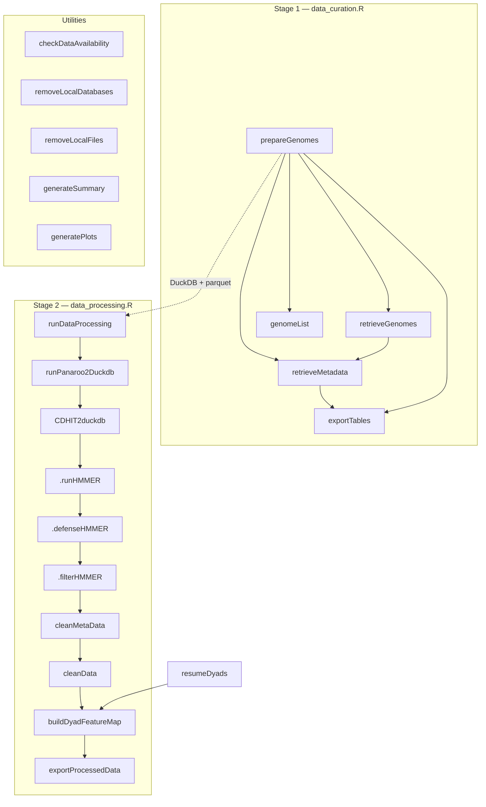

# amRdata function map

131 functions across 9 files in `R/`; 19 are exported. Line numbers are the function's definition (`file:start`) as of branch `overhaul` @ 2cc91df. Generated by parsing `R/*.R` and following symbol references, including default arguments. Calls made through strings or `do.call` are not captured.

## 1. Pipeline overview

Entry points are the exported functions. The two main drivers are `prepareGenomes()` (stage 1) and `runDataProcessing()` (stage 2); everything else is a standalone utility or a piece that a driver calls.

Stage order inside `runDataProcessing()` is Panaroo → CD-HIT → HMMER (Pfam/COG) → defense HMMER → filter → `cleanMetaData` → `cleanData` → dyads → export (`R/data_processing.R:3529-4296`). The code uses manifest helpers (section 4) to skip stages that were already completed.

## 2. Exported API

| Function | Location | Calls (direct, non-helper) | Called by |
|---|---|---|---|
| `prepareGenomes` | data_curation.R:2249 | `retrieveMetadata`, `.filterGenomes`, `retrieveGenomes`, `genomeList`, `exportTables` | — (user) |
| `retrieveMetadata` | data_curation.R:1212 | `.retrieveQueryIDs`, `.resolveGenomeIDsApi`, `.extractAMRtableApi`, `.extractGenomeDataApi`, `.extractAMRtable`, `.extractGenomeData`, `.parse_bvbrc_tsv`, `.apply_metadata_qc`, `.create_amr_tagged_view`, `exportTables` | `prepareGenomes`, `retrieveGenomes` |
| `retrieveGenomes` | data_curation.R:1871 | `retrieveMetadata`, `.filterGenomes`, `.ftps_download_two_pass`, `.cli_dump_fastas_gto_chunk`, `.cli_export_gff_chunk`, `.purge_genome_files`, `.list_complete` | `prepareGenomes` |
| `exportTables` | data_curation.R:2611 | `.amr_paths_from_duckdb`, `.preserve_export_id_text` | `retrieveMetadata`, `prepareGenomes` |
| `checkDataAvailability` | data_curation.R:2870 | `.checkDataPerTaxon` | — (user) |
| `.updateBVBRCdata` ¹ | data_curation.R:695 | `.fetchBVBRCdata`, `.amr_bfc_bvbrc_path` | `.retrieveCustomQuery` |
| `.extractAMRtable` ¹ | data_curation.R:1018 | — | `retrieveMetadata`, `.checkDataPerTaxon` |
| `runDataProcessing` | data_processing.R:3529 | `runPanaroo2Duckdb`, `CDHIT2duckdb`, `.runHMMER`, `.defenseHMMER`, `.filterHMMER`, `cleanMetaData`, `cleanData`, `buildDyadFeatureMap`, `exportProcessedData` | — (user) |
| `runPanaroo2Duckdb` | data_processing.R:970 | `.runPanaroo`, `.mergePanaroo`, `.panaroo2duckdb` | `runDataProcessing` |
| `CDHIT2duckdb` | data_processing.R:1255 | `.runCDHIT`, `.streamProteinClusters`, `.importProteinClusters`, `.clusterNames` | `runDataProcessing` |
| `cleanMetaData` | data_processing.R:2891 | `.amr_filter_evidence`, `.amr_resolve_evidence_mode`, `.write_compressed_parquet` | `runDataProcessing` |
| `cleanData` | data_processing.R:3093 | `.proteinAnnotations2Duckdb`, `.write_compressed_parquet` | `runDataProcessing` |
| `exportProcessedData` | data_processing.R:4334 | `.amr_resolve_export_orb`, `.exportDyadAnnotations`, `.preserve_export_id_text` | `runDataProcessing` |
| `buildDyadFeatureMap` | feature_to_head.R:136 | `.dyadHmmerSpecs`, `.dyadIdSql` | `runDataProcessing`, `resumeDyads` |
| `resumeDyads` | resume-dyads.R:13 | `buildDyadFeatureMap`, `.manifest_*` | — (user) |
| `removeLocalDatabases` | data_processing.R:28 | `.amr_bfc_remove_bvbrc`, `.amr_bfc_hmmer_resources`, `.defaultHmmerDbDir` | — (user) |
| `removeLocalFiles` | data_processing.R:4983 | `.amr_cleanup_datasets`, `.manifest_validate`, `.generateDBname` | — (user) |
| `generateSummary` | amRdataPlots.R:19 | — | — (user) |
| `generatePlots` | amRdataPlots.R:252 | `meta_palette` | — (user) |

¹ Exported despite the leading dot; the NAMESPACE lists `.updateBVBRCdata` and `.extractAMRtable` ([NAMESPACE:3](../NAMESPACE#L3), [NAMESPACE:4](../NAMESPACE#L4)). They are used internally only, so this may be unintended.

## 3. Internal functions by area

### BV-BRC retrieval (bvbrc_api.R, data_curation.R)
| Group | Functions |
|---|---|
| API request layer | `.bvbrcApiReq` bvbrc_api.R:18 → `.bvbrcApiFetch` :34 (uses `.bvbrcEnc` :30); `.bvbrcChunk` :69; `.bvbrcPrefixFill` :79; `.bvbrcFutureMap` helpers.R:618 |
| API extractors | `.extractAMRtableApi` :98, `.resolveGenomeIDsApi` :157, `.extractGenomeDataApi` :229 |
| Bulk-TSV path | `.updateBVBRCdata` data_curation.R:695 → `.fetchBVBRCdata` :338; `.retrieveCustomQuery` :807; `.retrieveQueryIDs` :909; `.parse_bvbrc_tsv` :399; `.extractAMRtable` :1018; `.extractGenomeData` :1094 |
| QC / evidence | `.apply_metadata_qc` :456; `.amr_filter_evidence` :28; `.amr_lab_methods` :5; `.create_amr_tagged_view` :64; `.filterGenomes` :1601 |
| Dataset naming | `.generateDBname` :880, `.id_checker` helpers.R:646, `.amr_dataset_paths` helpers.R:294, `.buildDBpath` helpers.R:535 |
| Availability check | `.checkDataPerTaxon` helpers.R:1419 (reimplements the API/TSV path for `checkDataAvailability`) |

### Genome download (data_curation.R)
`.ftps_download_two_pass` :188 → `.ftps_download_one` :111; `.is_complete_set` :1712, `.list_complete` :1723; `.cli_dump_fastas_gto_chunk` :1730, `.cli_export_gff_chunk` :1776 (both use `.pick_shell`, `.docker_path`; sanitised by `.strip_fasta_preamble` helpers.R:1337 and `.sanitize_gff` :1356); `.purge_genome_files` :631.

### Pangenome / clustering (data_processing.R)
| Group | Functions |
|---|---|
| Panaroo | `.runPanaroo` :305 → `.processPanaroo` :164, `.stripPseudogeneGFFs` helpers.R:2764, `.removeAllXCDSGFFs` :2870; `.mergePanaroo` :455; `.panaroo2duckdb` :724 → `.importPanarooTables` :532, `.importPanarooReference` :687 |
| CD-HIT | `.runCDHIT` :748; `.streamProteinClusters` :1063; `.importProteinClusters` :1161; `.clusterNames` :1238 |

### HMMER / annotation (data_processing.R, helpers.R)
| Group | Functions |
|---|---|
| Pfam/COG run | `.runHMMER` :1832 → `.prepareHmmerDatabases` :1349, `.runHmmerJob` :1705 |
| Defense run | `.defenseHMMER` :2201 |
| Shared parsing | `.parseHMMEROutput` helpers.R:3716, `.hmmerHits` :3805, `.isValidHmmFile` :3494, `.parse_hmmer_profiles` :3528, `.hmmer_profile_cache` :3631, `.hmmer_version` :3843, `.defaultHmmerDbDir` :3836 |
| Filtering / output | `.filterHMMER` :2738 (GA/TC gate, E-value, best hit per region), `.proteinAnnotations2Duckdb` :2080, `.write_compressed_parquet` helpers.R:3825 |

### Dyads (feature_to_head.R, data_processing.R)
`.dyadHmmerSpecs` :8, `.dyadIdSql` :84 (both used by `buildDyadFeatureMap`, `.exportDyadAnnotations`, `resumeDyads`); `.exportDyadAnnotations` helpers.R:2971.

## 4. Shared infrastructure (helpers.R)

| Family | Functions | Main consumers |
|---|---|---|
| Paths & DB connections | `.amr_paths_from_duckdb` :339, `.amr_paths_from_dataset_db` :391, `.amr_connect_dataset_db` :465, `.amr_resolve_export_orb` :3217 | nearly every stage |
| BiocFileCache (`.amr_bfc*`) | `.amr_bfc` :682, `.amr_bfc_find` :691, `.amr_bfc_bvbrc_path` :707, `.amr_bfc_remove_bvbrc` :759, `.amr_bfc_hmmer_rname` :807, `.amr_bfc_bvbrc_rname` :815, `.amr_bfc_register_hmmer` :820, `.amr_bfc_hmmer_resources` :858, `.amr_bfc_register_local` :871, `.amr_bfc_manifest_rname` :2162 | BV-BRC download, HMMER DBs, `removeLocalDatabases` |
| Dataset selection / cleanup | `.amr_processing_datasets` :910, `.amr_select_processing_dataset` :1264, `.amr_cleanup_datasets` :1087, `.amr_resolve_evidence_mode` :1226 | `runDataProcessing`, `removeLocalFiles` |
| Run manifest | `.manifest_run_id` :2051, `.manifest_start` :2073, `.manifest_stage` :2257, `.manifest_event` :2340, `.manifest_artifact` :2172, `.manifest_finish` :2381, `.manifest_find_latest` :2563, `.manifest_validate` :2203, `.manifest_resume` :2646, `.manifest_prior_stage` :2493, `.resume_plan` :2526, plus `.manifest_file_info`, `.manifest_git_info`, `.manifest_package_versions` | `prepareGenomes`, `runDataProcessing`, `resumeDyads` |
| Parallelism | `.resolve_workers` :559, `.amr_set_future_plan` :606 | download, Panaroo, CD-HIT, HMMER, API |
| Progress / logging | `.amr_status` :22, `.amr_progress_available` :50, `.amr_progress_handler` :74, `.amr_with_progress` :125, `.amr_progressor` :207, `.amr_progress_step` :244, `.log_write` :2443, `.log_tool_output` :2455, `.log_or_message` :2471 | all long-running stages |
| Docker / shell | `.docker_path` :1321, `.to_container` :2725, `.pick_shell` :1325 | Panaroo, CD-HIT, HMMER, GFF/FASTA export |
| Misc | `.amr_download_file` :155, `.preserve_export_id_text` :655 | HMMER DB download, exports |

## 5. Plotting (amRdataPlots.R, utils_colors.R)
`generateSummary` :19 and `generatePlots` :252 are standalone. `generatePlots` uses `meta_palette` (utils_colors.R:33). They don't call or get called by any pipeline function.

## 6. Observations

- **Exported with a dot prefix:** `.updateBVBRCdata` and `.extractAMRtable` (see footnote ¹).
- **Duplicate retrieval logic:** `.checkDataPerTaxon` (helpers.R:1419-1927, ~500 lines) re-implements the metadata path that `retrieveMetadata` (data_curation.R:1212-1581) already contains. Both call the same extractors and QC.
- **Large functions:** `removeLocalFiles` (~930 lines), `runDataProcessing` (~770), `buildDyadFeatureMap` (~650), `exportProcessedData` (~620), `prepareGenomes` (~340), `.defenseHMMER` (~490). These are the natural refactor targets.
- **Layout:** `helpers.R` (3,867 lines) holds several unrelated families (BFC cache, manifest, HMMER parsing, dyad export, availability check). Splitting it by the families in section 4 would make the map above match the files.
- **Misplaced:** `.exportDyadAnnotations` lives in helpers.R:2971 but belongs with `feature_to_head.R`; `.checkDataPerTaxon` belongs with `checkDataAvailability` in data_curation.R.
